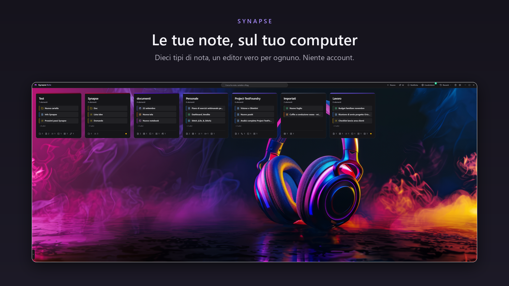
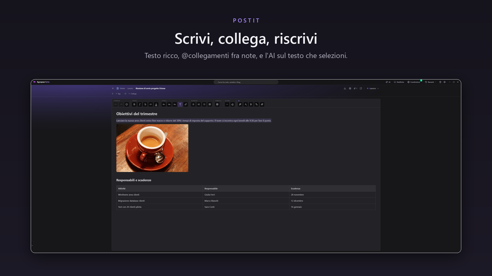
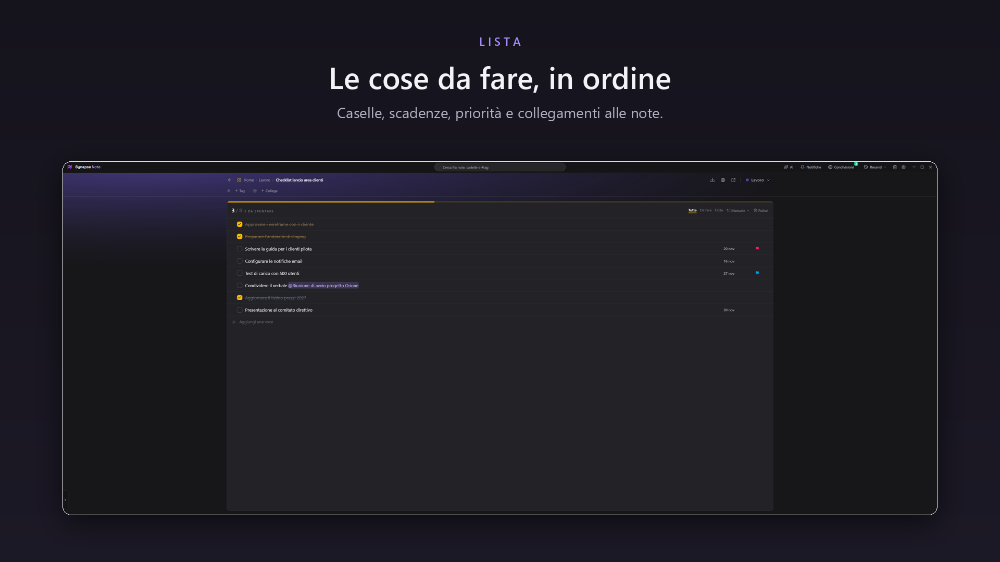
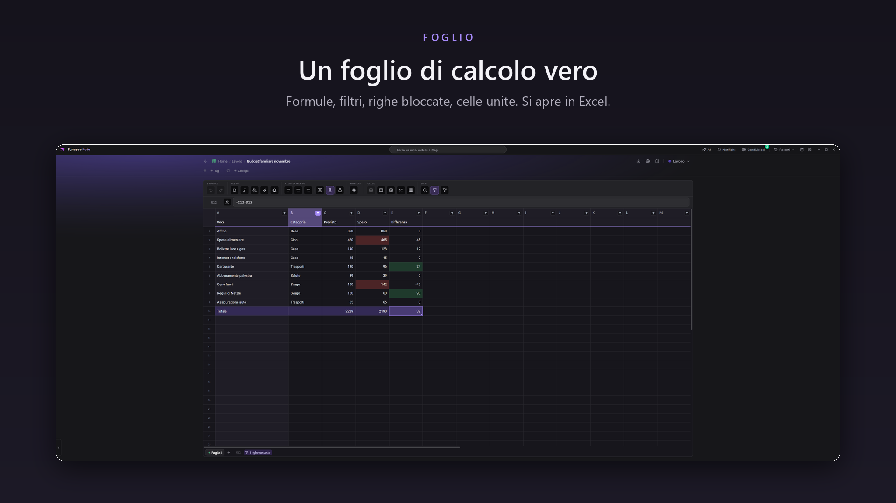
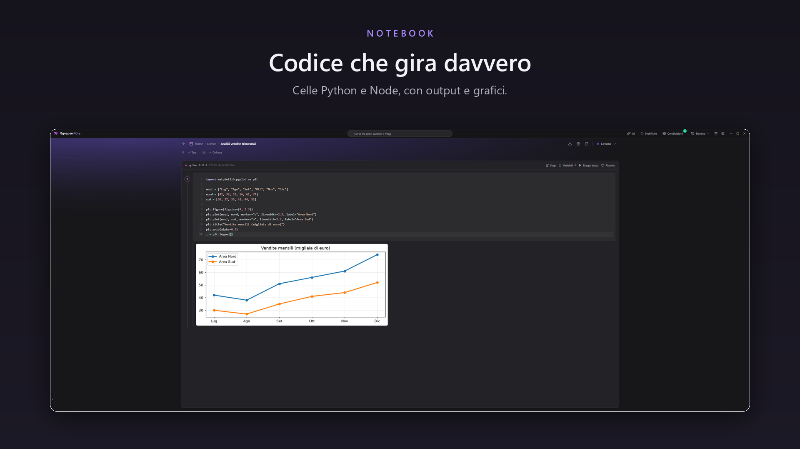
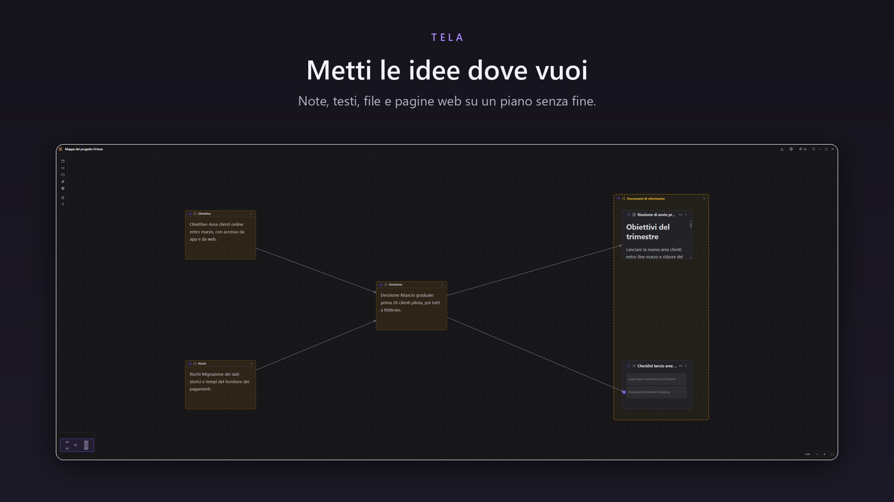
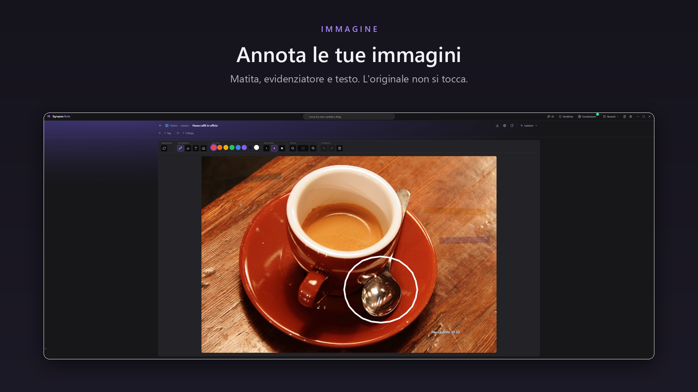
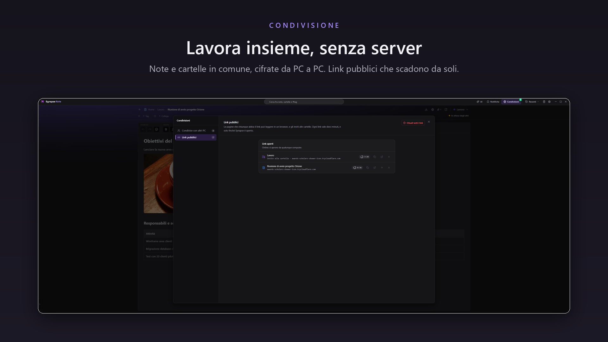
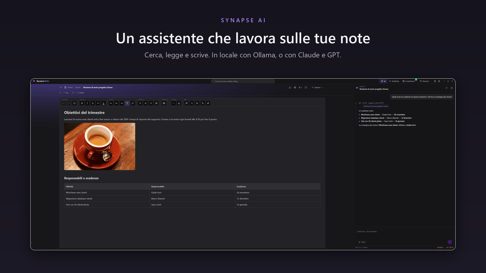

<div align="center">

# Synapse

**Le tue note, sul tuo computer. Dieci tipi di nota, un editor vero per ognuno, la condivisione fra PC e un assistente AI che gira in locale o in rete.**

[](../../releases/latest)
[](../../releases)
[](../../releases/latest)

[🇬🇧 English](README.md) · 🇮🇹 Italiano

<br>



</div>

---

## In due righe

Synapse è un'app di note per Windows che gira **sul tuo computer**. Nessun account, nessuna telemetria: i dati stanno in un file SQLite nella tua cartella. Da lì non esce niente se non lo decidi tu: condividendo una nota, o scegliendo un'AI in rete.

La differenza con le altre app di note è che qui una nota non è una sola cosa: sono **dieci tipi diversi**, ognuno col suo editor vero, più un assistente che li sa leggere e scrivere.

> **Questa repository contiene l'applicazione, non il codice sorgente.** Qui trovi il download, la documentazione e le note di rilascio.

---

## Scarica

**[⬇️ Ultima versione per Windows](../../releases/latest)**, oppure dal **[Microsoft Store](https://apps.microsoft.com/detail/9N8XRTWQGWRS?hl=it-it&gl=IT&ocid=pdpshare)**.

Scarica `Synapse_x.y.z_x64-setup.exe` e aprilo. L'installazione non richiede altro.

| | |
| --- | --- |
| **Sistema** | Windows 10 (1809+) o Windows 11, 64 bit |
| **Spazio** | ~60 MB installata |
| **Lingue** | italiano, inglese, spagnolo, francese |
| **Dipendenze** | nessuna obbligatoria |
| **Facoltativi** | [Ollama](https://ollama.com) o una chiave API per l'assistente, [Python](https://www.python.org) per le celle eseguibili |

Al primo avvio una breve configurazione ti chiede cosa vuoi: il motore dell'AI, Python, il programma per i link pubblici e una password principale per gli archivi di password. Tutto tranne la password principale si può saltare e fare dopo dalle Impostazioni.

Windows può mostrare l'avviso di SmartScreen la prima volta che apri l'installer di GitHub: è normale per un installer non ancora firmato con un certificato commerciale. **Ulteriori informazioni → Esegui comunque.** La versione del Microsoft Store non lo mostra.

---

## L'idea sotto: tutto è testo

Quasi ogni nota ha il contenuto salvato come **testo semplice**.

| Tipo | Formato del contenuto |
| --- | --- |
| Postit | Markdown |
| Lista | Markdown task-list (`- [ ] cosa fare`) |
| Foglio | CSV |
| Diagramma | sorgente Mermaid |
| Notebook | Markdown con blocchi ```` ```python ```` |
| API | JSON o YAML OpenAPI |
| Tela | JSON di scena |
| Immagine | il file come allegato, le annotazioni in JSON |
| Video | il file come allegato |
| Archivio password | *(vuoto: i segreti stanno cifrati in una tabella a parte)* |

Non è un dettaglio tecnico, è la regola che tiene in piedi il resto:

- **si cerca dentro tutto**, senza un parser per tipo;
- **si esporta tutto**, senza formati opachi;
- **l'assistente legge e scrive le note di testo**, senza casi speciali;
- un notebook aperto come postit resta un documento sensato.

---

## I dieci tipi di nota

<div align="center">

| | |
| :---: | :---: |
|  |  |
| **Postit**: testo ricco, allegati, collegamenti fra note | **Lista**: caselle, scadenze, priorità |
|  |  |
| **Foglio**: formule vere, filtri, celle unite | **Notebook**: celle Python e Node che girano davvero |
|  |  |
| **Tela**: blocchi su un piano senza fine | **Immagine**: annotazioni sopra, l'originale intatto |

</div>

### 📝 Postit
Testo ricco in Markdown: titoli, elenchi, tabelle, citazioni, codice, colori del testo, immagini incollate o trascinate dentro, allegati di qualunque tipo. La barra degli strumenti è divisa in gruppi con il loro nome, e ogni pulsante dice cosa fa quando ci passi sopra. Scrivi `@` e compaiono le tue note: il collegamento resta vivo anche se la nota cambia titolo, e un clic la apre in una finestra sua. In una nota nuova il titolo è già selezionato: `Invio` o `Tab` passano al testo.

**Con l'assistente:** seleziona del testo e usa il gruppo AI della barra: *Riscrivi, Correggi, Accorcia, Traduci, Chiedi*. Il testo si riscrive al suo posto, e `Ctrl+Z` lo riporta indietro.

### ✅ Lista
Cose da fare: caselle, rientri fino a quattro livelli, riordino trascinando, scadenze (`📅 2026-12-31`) e priorità (⏫ 🔼 🔽). Scrivi `@` in una voce per collegarla a una nota. Il contenuto resta Markdown, quindi la stessa nota letta come postit ha comunque senso.

### 📊 Foglio
Un foglio di calcolo vero: formule (`=SOMMA(B2:B5)`), riempimento automatico trascinando, trova e sostituisci, colori di cella, liste a discesa.
- **Filtri** per colonna e ordinamento A→Z / Z→A.
- **Blocca** righe e colonne in base a quel che selezioni, anche insieme.
- **Unisci** celle in orizzontale e in verticale, allineamento verticale, copia formato.
- `=OGGI()`, `=ORA()`, `=IERI()`, `=DOMANI()` scrivono il valore una volta sola, e resta quello.

Il contenuto resta CSV: si apre in Excel senza conversioni.

### 🔀 Diagramma
Lo scrivi, si disegna. Sorgente **Mermaid**: flowchart, sequenze, classi, stati, gantt, ER, mindmap, timeline, git graph e il resto. Anteprima viva mentre scrivi, una galleria di modelli, pan e zoom sul disegno.

### 🧪 Notebook
Celle di codice che **girano davvero**, con un interprete installato sul computer: **Python** e **Node**. Le celle si passano lo stato, l'output arriva mentre la cella lavora, i grafici matplotlib tornano come immagini. Gli output non si salvano: durano quanto la nota resta aperta.

### 🔌 API
Una specifica **OpenAPI/Swagger** da leggere: la incolli o la prendi da un indirizzo, e diventa un elenco navigabile di endpoint con parametri, schemi, risposte ed esempi.

### 🎨 Tela
Blocchi appoggiati su un piano senza fine: testi, note collegate, cartelle, file, immagini, gruppi, etichette, frecce fra un blocco e l'altro, e perfino pagine web vive dentro un blocco. Per quando le cose stanno insieme per **come sono disposte**.

### 🖼️ Immagine
Un'immagine dal computer (anche SVG), incollata o trascinata nell'app, pronta da annotare: matita, evidenziatore, testo e gomma, con colori e spessori, annulla e ripeti, `Ctrl+rotellina` per lo zoom. Il file originale non si tocca mai: si esporta come PNG annotato oppure com'era.

### 🎬 Video
Un video dal computer, conservato e riprodotto dentro Synapse. Synapse lo conserva e lo riproduce, ma non lo modifica.

### 🔒 Archivio password
La nota che non è una nota: i suoi dati non stanno nel contenuto, stanno **cifrati** in una tabella a parte. Si apre con la password principale, si richiude da solo dopo un po', e ha il generatore di password. Non si cerca, non si esporta in chiaro, non si condivide, e l'assistente non lo vede mai.

---

## Tag e collegamenti

Ogni tipo di nota può avere **#tag** e **@collegamenti** ad altre note, dalla barra sotto il titolo. I #tag scritti nel testo si evidenziano, e una nota appoggiata su una tela conta come collegamento. I tag si cercano dalla barra in alto: l'elenco dei tag con quante note ha ognuno, poi tutte le note di quel tag.

---

## Condivisione

<div align="center">

</div>

Due cose diverse, che avvii tu e fermi quando vuoi. Le trovi tutte in un posto solo: **Condivisioni**, nella barra in alto.

**Link pubblico.** Il mappamondo dentro una nota crea un link che si apre in qualunque browser, per ogni tipo di nota tranne gli archivi di password. Synapse serve la pagina dal tuo computer attraverso un tunnel gratuito di Cloudflare (senza account). Il link vale **10 minuti**, e solo finché Synapse è aperto; il tempo che resta si vede in Condivisioni. Condividendo una tela partono anche le note collegate.

**Note e cartelle in comune.** Inviti qualcuno in una nota o in un'intera cartella con un link che lascia **modificare** o solo **leggere**. Prima che qualcuno entri vedi il suo nome e decidi tu. Le modifiche viaggiano dal vivo finché le due app sono aperte, allegati e immagini compresi (fino a 100 MB l'uno).
- Il collegamento è **cifrato end-to-end** da PC a PC: in mezzo non c'è nessun server di Synapse.
- Vedi dove sta lavorando l'altra persona: la cella nel foglio, il puntatore sulla tela, la voce nella lista, la cella nel notebook.
- Da Condivisioni vedi chi c'è, cambi i permessi e smetti di condividere. Una nota eliminata dall'altra persona mostra un avviso con *Ripristina*.
- Gli archivi di password non viaggiano mai.

---

## Synapse AI

<div align="center">

</div>

Un assistente con gli strumenti veri dell'app. Scegli tu chi risponde, al primo avvio o in Impostazioni → *Intelligenza artificiale*:

| Motore | Dove gira |
| --- | --- |
| **Ollama** | sul tuo computer: nessun testo esce da qui |
| **Claude** (Anthropic) | in rete, con la tua chiave API |
| **GPT** (OpenAI) | in rete, con la tua chiave API |
| **Compatibile OpenAI** | il server di cui scrivi l'indirizzo: LM Studio, vLLM, OpenRouter, un server aziendale… La chiave è facoltativa |

Con un motore in rete, le tue richieste, la nota aperta e le note che l'assistente legge vanno a quel fornitore, e l'uso si paga sul tuo conto. Le chiavi API stanno in Gestione credenziali di Windows, non nel database. Gli archivi di password non vengono mai inviati, con nessun motore.

Non è una chat attaccata di lato: è una **colonna dell'app**, e ha gli strumenti dell'app:

| Strumento | Cosa fa |
| --- | --- |
| `cerca_note` | cerca fra tutte le note, per parole, tag e date |
| `leggi_nota` | legge una nota trovata |
| `elenca_struttura` | guarda com'è organizzata la libreria, sottocartelle comprese |
| `crea_nota` | scrive una nota nuova del tipo giusto, in un formato che si apre |
| `aggiorna_nota` | modifica una nota: aggiunge, trova e sostituisce, o riscrive |
| `crea_tela` | costruisce una tela con note, testi, pagine web e frecce |
| `crea_cartella` · `sposta_nota` · `cestina_nota` | mette ordine |
| `cerca_web` · `leggi_pagina` | va a guardare in rete |

Li **concatena**: cerca, legge quel che ha trovato, poi scrive. Ogni passo resta scritto lungo la risposta, e le pastiglie della traccia aprono la nota o la cartella che ha toccato. Se una modifica non ti piace, *annulla* riporta le versioni precedenti delle note toccate.

Sa dove sei (la nota aperta, la cartella in cui ti trovi, le note toccate di recente) e chi sei (due righe che scrivi nelle impostazioni, e che puoi rileggere e cancellare quando vuoi). Scrivi `@` nella chat per partire da una nota precisa.

---

## Tutto il resto

**Organizzare**: categorie colorate in home, cartelle annidate quanto serve, alberatura sempre a sinistra (`Ctrl+L`), selezione a rettangolo, copia/taglia/incolla, ordinamento ricordato per cartella.

**Finestre**: una nota si stacca in una finestra sua (assistente compreso), o si appunta sulla scrivania sopra a tutto.

**Nota veloce**: `Ctrl+Alt+N` da qualunque programma tu stia usando: compare una finestrella, scrivi, `Ctrl+Invio`, sparisce.

**Ricerca**: dalla barra in alto, mentre scrivi, su titoli, contenuti e tag di ogni tipo, con il percorso completo sotto ogni risultato.

**Import**: trascina un file dentro. PDF e Word diventano postit, Excel e CSV diventano fogli, `.ipynb` diventa un notebook, immagini (anche SVG) e video diventano note loro.

**Export**: ogni tipo esce nel formato che gli somiglia. Postit e liste in Word, fogli in Excel (coi valori calcolati), diagrammi in PNG, notebook in `.ipynb`, immagini come PNG annotato o file originale, archivi come ZIP protetto da password. Una cartella intera esce come un PDF unico.

**Cestino**: «elimina» non cancella. Le cose finiscono nel cestino, e per 30 giorni si torna indietro.

**Dati e backup**: scegli tu dove sta la cartella dei dati; il backup è uno ZIP con database e allegati, a mano o automatico, tenendo le ultime N copie.

**Aspetto e lingua**: tema chiaro/scuro/di sistema, sfondo personalizzato, carattere, zoom, tavolozze per i colori delle categorie. L'interfaccia parla italiano, inglese, spagnolo e francese, oppure segue il computer.

---

## Privacy

- **Locale di partenza.** Un file SQLite nella tua cartella dati. Nessun account, nessun server nostro, nessuna telemetria.
- **L'AI la scegli tu.** Con Ollama e un modello scaricato in locale, le note non escono dal computer. Con Claude, GPT o un server compatibile OpenAI, quel che l'assistente legge va a quel fornitore.
- **La condivisione la attivi tu.** Un link pubblico passa da Cloudflare e vale 10 minuti. Note e cartelle in comune viaggiano cifrate end-to-end da PC a PC.
- **Gli archivi di password** usano una chiave derivata con **Argon2id** (64 MB, 3 passate) e il contenuto cifrato con **AES-256-GCM**, con un nonce nuovo a ogni scrittura. Non si condividono, non vanno all'AI, non si cercano.
- **La password principale non è salvata da nessuna parte.** Se la dimentichi i segreti sono persi, ed è proprio per questo che nessun altro può aprirli.
- **Ollama e Python non sono inclusi**: Synapse usa quel che c'è sul tuo computer, e senza l'app funziona lo stesso, solo senza assistente locale e senza celle eseguibili.

La dichiarazione completa, con ogni connessione di rete che l'app può fare, è nell'[informativa sulla privacy](PRIVACY.it.md).

---

## Scorciatoie

| Tasti | Cosa fa |
| --- | --- |
| `Ctrl+Alt+N` | nota veloce, da qualunque programma |
| `Ctrl+Alt+Invio` | mostra e nasconde l'app, da qualunque programma |
| `Ctrl+K` | apre e chiude Synapse AI |
| `Ctrl+L` | apre e chiude l'alberatura |
| `Ctrl+F` | cerca dentro la nota aperta |
| `Ctrl+rotellina` | ingrandisce e rimpicciolisce un'immagine |
| `Esc` | torna indietro di un passo |
| Tasto destro | ovunque: le azioni di quella cosa |

---

## Domande

**Dove finiscono i miei dati?**
In `C:\Users\<tu>\.synapse`: database, allegati e sfondi. Dalle impostazioni puoi spostare la cartella dove vuoi, anche su un altro disco.

**Come faccio un backup?**
Impostazioni → *Dati e backup*. A mano quando vuoi, o in automatico (a ogni avvio, ogni giorno, ogni settimana), tenendo le ultime N copie. Il file `.synapsebak` è uno ZIP con dentro database e allegati.

**Serve una connessione a internet?**
No. Solo per quel che va in rete per natura: la condivisione, un motore AI in rete, la ricerca sul web, una pagina web dentro una tela.

**C'è un abbonamento?**
No. Nessun account, nessun pagamento, nessun limite. Se scegli Claude, GPT o un servizio compatibile OpenAI a pagamento, è quel fornitore a farti pagare l'uso.

**Posso usarla senza Ollama?**
Sì. Usa un motore in rete con la tua chiave API, o nessun assistente: tutto il resto funziona.

**Il codice sorgente è disponibile?**
Non in questa repository. Qui ci sono l'applicazione e la sua documentazione.

---

## Segnalare un problema

Apri una [issue](../../issues) e scrivi cosa stavi facendo, cosa ti aspettavi e cosa è successo invece. Se l'app si è aperta vuota o ha dato un errore, allega questo file:

```
%APPDATA%\com.scrig.synapse\errori.log
```

*(Se hai spostato la cartella dati, il log è in quella nuova.)*

---

<div align="center">

Fatta da **Danilo Scrignoli** · Windows · Tauri 2 · SQLite

</div>
