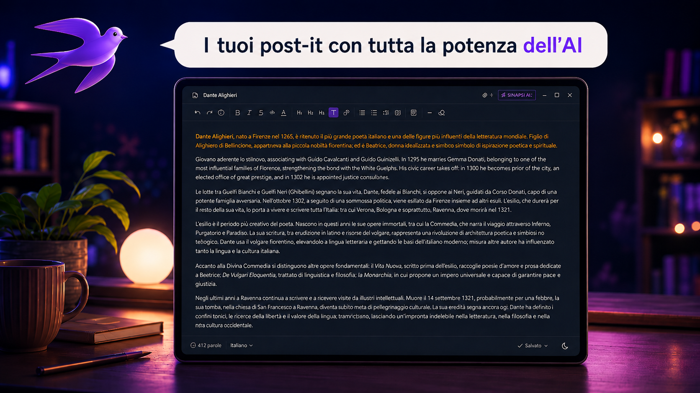
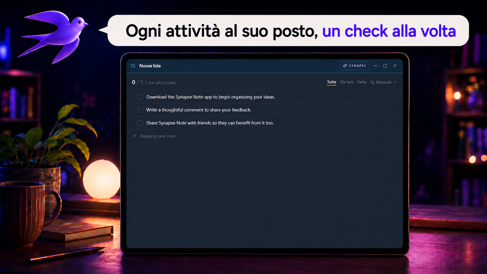
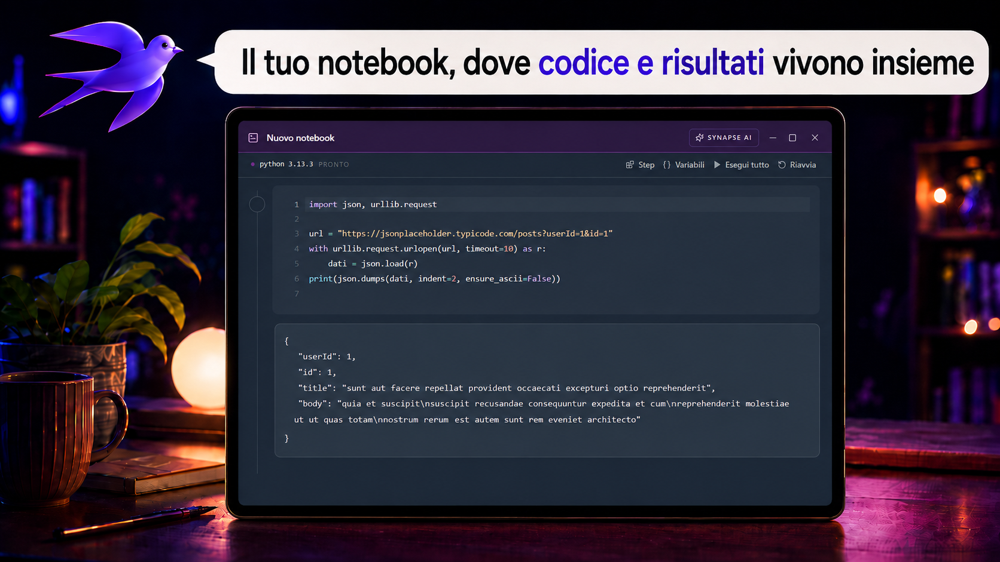
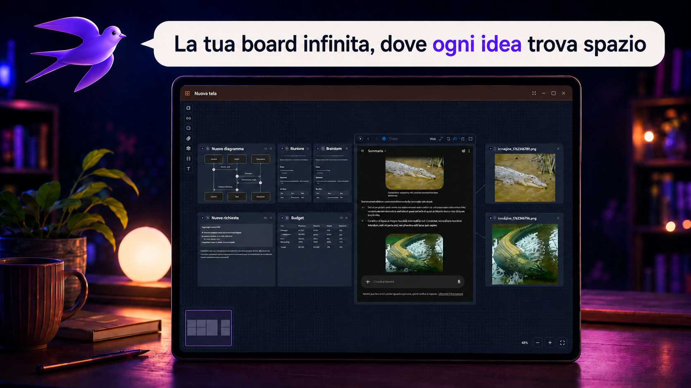

<div align="center">

# Synapse

**Le tue note, sul tuo computer. Otto tipi di nota, un editor vero per ognuno, e un assistente che gira in locale.**

[](../../releases/latest)
[](../../releases)
[](../../releases/latest)

[🇬🇧 English](README.md) · 🇮🇹 Italiano

<br>


</div>

---

## In due righe

Synapse è un'app di note per Windows che gira **interamente sul tuo computer**. Nessun account, nessuna sincronizzazione, nessuna telemetria: i dati stanno in un file SQLite nella tua cartella, e basta.

La differenza con le altre app di note è che qui una nota non è una sola cosa: sono **otto tipi diversi**, ognuno col suo editor vero — e un assistente locale che li sa leggere e scrivere tutti.

> **Questa repository contiene l'applicazione, non il codice sorgente.** Qui trovi il download, la documentazione e le note di rilascio.

---

## Scarica

**[⬇️ Ultima versione per Windows](../../releases/latest)**

Scarica `Synapse_x.y.z_x64-setup.exe` e aprilo. L'installazione non richiede altro.

| | |
| --- | --- |
| **Sistema** | Windows 10 (1809+) o Windows 11, 64 bit |
| **Spazio** | ~60 MB installata |
| **Dipendenze** | nessuna obbligatoria |
| **Facoltativi** | [Ollama](https://ollama.com) per l'assistente, [Python](https://www.python.org) per le celle eseguibili |

Windows può mostrare l'avviso di SmartScreen la prima volta: è normale per un installer non ancora firmato con un certificato commerciale. **Ulteriori informazioni → Esegui comunque.**

---

## L'idea sotto: tutto è testo

Ogni nota, di qualunque tipo, ha il contenuto salvato come **testo semplice**.

| Tipo | Formato del contenuto |
| --- | --- |
| Postit | Markdown |
| Lista | Markdown task-list (`- [ ] cosa fare`) |
| Foglio | CSV |
| Diagramma | sorgente Mermaid |
| Notebook | Markdown con blocchi ```` ```python ```` |
| API | JSON o YAML OpenAPI |
| Tela | JSON di scena |
| Archivio password | *(vuoto — i segreti stanno cifrati in una tabella a parte)* |

Non è un dettaglio tecnico, è la regola che tiene in piedi il resto:

- **si cerca dentro tutto**, senza un parser per tipo;
- **si esporta tutto**, senza formati opachi;
- **l'assistente legge e scrive tutto**, senza casi speciali;
- un notebook aperto come postit resta un documento sensato.

---

## Gli otto tipi di nota

<div align="center">

| | |
| :---: | :---: |
|  |  |
| **Postit** — testo ricco, allegati, collegamenti fra note | **Lista** — caselle, scadenze, priorità |
|  |  |
| **Notebook** — celle Python e Node che girano davvero | **Tela** — blocchi su un piano infinito |

</div>

### 📝 Postit
Testo ricco in Markdown. Titoli, elenchi, tabelle, citazioni, codice, colori del testo, immagini incollate o trascinate, allegati di qualunque tipo. Scrivendo `[[` compare l'elenco delle tue note: il collegamento resta vivo anche se la nota cambia titolo.

**Con l'assistente:** evidenzia una frase e scegli *riscrivi, correggi, accorcia, traduci*, o chiedi a parole cosa farne. Il testo si riscrive sul posto, e `Ctrl+Z` lo riporta indietro.

### ✅ Lista
Cose da fare: caselle da spuntare, rientri fino a quattro livelli, riordino trascinando, scadenze (`📅 2026-12-31`) e priorità (⏫ 🔼 🔽). Il contenuto resta Markdown, quindi la stessa nota letta come postit ha comunque senso.

### 📊 Foglio
Un foglio di calcolo vero: formule (`=SOMMA(B2:B5)`), riempimento automatico trascinando, trova e sostituisci, filtri per colonna, validazione delle celle, colori di sfondo. Il contenuto resta CSV: si apre in Excel senza conversioni.

### 🔀 Diagramma
Lo scrivi, si disegna da solo. Sorgente **Mermaid**: flowchart, sequence, class, state, gantt, ER, mindmap, timeline, git graph e il resto. Anteprima viva mentre scrivi, galleria di modelli, pan e zoom sul disegno.

### 🧪 Notebook
Celle di codice che **girano davvero**, in un interprete installato sul tuo computer: **Python** e **Node**. Le celle condividono lo stato, l'output scorre mentre la cella lavora, i grafici matplotlib diventano immagini. Gli output non vengono salvati: durano quanto la nota resta aperta.

### 🔌 API
Una specifica **OpenAPI/Swagger** da leggere: si incolla o si prende da un indirizzo, e diventa un elenco di endpoint navigabili con parametri, schemi, risposte ed esempi.

### 🎨 Tela
Blocchi appoggiati su un piano infinito: testi, note collegate, file, immagini, riquadri, etichette, frecce fra un blocco e l'altro — e persino pagine web vive dentro un blocco. Serve quando le cose stanno insieme per **come sono disposte**.

### 🔒 Archivio password
La nota che non è una nota: i suoi dati non stanno nel contenuto, stanno **cifrati** in una tabella a parte. Si apre con la password principale, si richiude da solo, ha un generatore di password. Non si cerca, non si esporta in chiaro, l'assistente non lo vede.

---

## Synapse AI

<div align="center">

</div>

Un assistente che gira **in locale** con [Ollama](https://ollama.com). Nessun testo esce dal computer.

Non è una chat di lato: è una **colonna dell'app**, e ha gli strumenti veri —

| Strumento | Cosa fa |
| --- | --- |
| `cerca_note` | cerca fra tutte le tue note |
| `leggi_nota` | legge una nota trovata |
| `elenca_struttura` | guarda com'è organizzata la libreria |
| `crea_nota` | scrive una nota nuova, del tipo giusto |
| `aggiorna_nota` | riscrive una nota che c'è già |
| `crea_cartella` · `sposta_nota` · `cestina_nota` | mette ordine |
| `cerca_web` · `leggi_pagina` | va a vedere in rete |

Li **concatena**: cerca, legge quel che ha trovato, poi scrive. Tutto quello che fa resta scritto passo per passo, e le pastiglie della traccia sono cliccabili: aprono la nota o la cartella che ha toccato.

Sa dove sei (la nota aperta, la cartella in cui stai) e sa chi sei (due righe scritte da te nelle impostazioni, che rileggi e cancelli quando vuoi).

---

## Il resto

**Organizzare** — categorie colorate in home, cartelle annidate a piacere, alberatura sempre a sinistra (`Ctrl+L`), selezione a rettangolo, copia/taglia/incolla, ordinamento ricordato per cartella.

**Le finestre** — una nota si stacca in una finestra sua (con l'assistente dentro), o si appiccica sulla scrivania sopra tutte le altre.

**Nota veloce** — `Ctrl+Alt+N` da qualunque programma: compare una finestrella, scrivi, `Ctrl+Invio`, sparisce.

**Cercare** — dalla barra in alto, mentre digiti, dentro titoli e contenuti di tutti i tipi, col percorso completo sotto ogni risultato.

**Importare** — trascina un file dentro: PDF e Word diventano postit, Excel e CSV diventano fogli, `.ipynb` diventa un notebook.

**Esportare** — ogni tipo esce nel formato che gli somiglia: postit e liste in Word, fogli in Excel (coi valori calcolati), diagrammi in PNG, notebook in `.ipynb`, archivi in ZIP protetto. Una cartella intera esce come PDF unico.

**Il cestino** — «elimina» non cancella: manda nel cestino, e da lì si torna indietro per 30 giorni.

**Dati e backup** — la cartella dei dati la scegli tu; il backup è uno ZIP con database e allegati, a mano o automatico con rotazione delle copie.

**Aspetto** — tema chiaro/scuro/di sistema, sfondo personalizzato, carattere, zoom, sette tavolozze per i colori delle categorie.

---

## Privacy

- **Tutto in locale.** Un file SQLite nella tua cartella dati. Nessun account, nessun server, nessuna telemetria.
- **L'assistente gira sul tuo computer** con Ollama: con un modello scaricato in locale, le note non escono. L'eccezione sono i modelli *cloud* di Ollama — vedi l'[informativa](PRIVACY.it.md).
- **Gli archivi password** usano una chiave derivata con **Argon2id** (64 MB, 3 passate) e contenuto cifrato con **AES-256-GCM**, con un nonce nuovo per ogni scrittura.
- **La password principale non è salvata da nessuna parte.** Se la dimentichi, i segreti sono persi — ed è esattamente la ragione per cui nessun altro può aprirli.
- **Niente viene mandato da nessuna parte.** Il testo completo è nell'[informativa sulla privacy](PRIVACY.it.md).
- **Ollama e Python non sono impacchettati**: si usa quel che c'è sulla macchina, e senza, l'app funziona lo stesso — solo senza assistente e senza celle eseguibili.

---

## Scorciatoie

| Tasti | Cosa fa |
| --- | --- |
| `Ctrl+Alt+N` | nota veloce, da qualunque programma |
| `Ctrl+Alt+Invio` | mostra e nasconde l'app, da qualunque programma |
| `Ctrl+K` | apre e chiude Synapse AI |
| `Ctrl+L` | apre e chiude l'alberatura |
| `Ctrl+F` | cerca dentro la nota aperta |
| `Esc` | torna indietro di un passo |
| Tasto destro | ovunque: le azioni di quella cosa |

---

## Domande

**Dove finiscono i miei dati?**
In `C:\Users\<tu>\.synapse` — database, allegati e sfondi. Dalle impostazioni puoi spostare la cartella dove vuoi, anche su un altro disco.

**Come faccio un backup?**
Impostazioni → *Dati e backup*. A mano quando vuoi, o automatico (a ogni avvio, ogni giorno, ogni settimana) tenendo le ultime N copie. Il file `.synapsebak` è uno ZIP con dentro database e allegati.

**Serve internet?**
No. Solo se chiedi all'assistente di cercare in rete, o se apri una pagina web dentro una tela.

**Serve un abbonamento?**
No. Nessun account, nessun pagamento, nessun limite.

**Posso usarla senza Ollama?**
Sì. Senza, non c'è l'assistente: tutto il resto funziona.

**Il codice sorgente è disponibile?**
No, non in questa repository. Qui ci sono l'applicazione e la documentazione.

---

## Segnalare un problema

Apri una [issue](../../issues) e scrivi cosa stavi facendo, cosa ti aspettavi e cosa è successo. Se l'app si è aperta bianca o è andata in errore, allega il file:

```
%APPDATA%\com.scrig.synapse\errori.log
```

*(Se hai spostato la cartella dei dati, il registro è nella cartella nuova.)*

---

<div align="center">

Fatto da **Danilo Scrignoli** · Windows · Tauri 2 · SQLite

</div>
