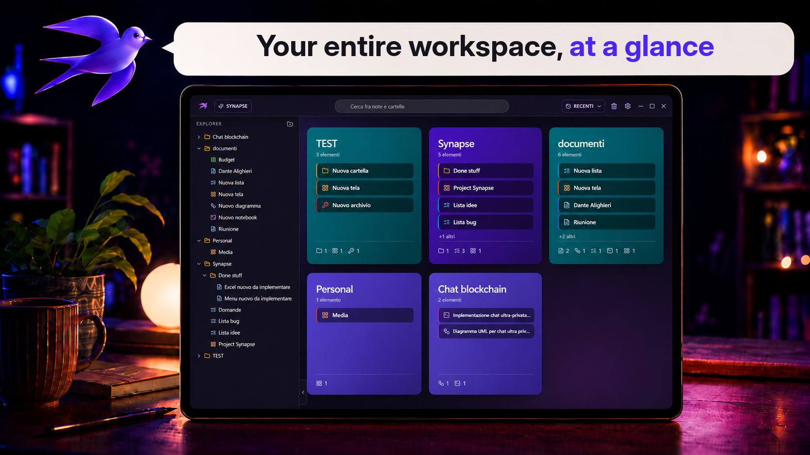
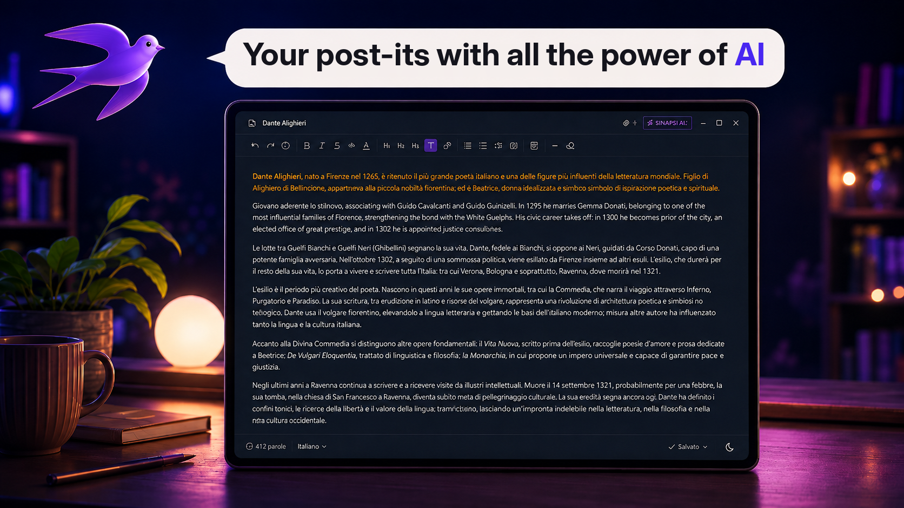
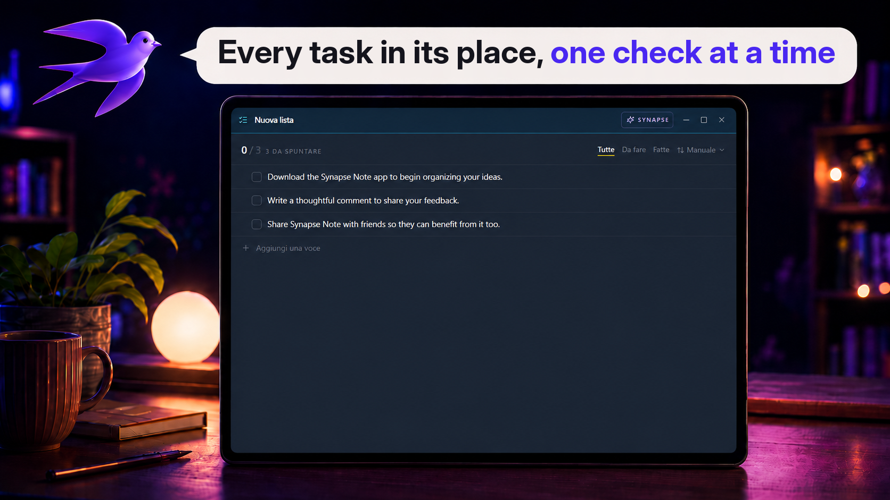
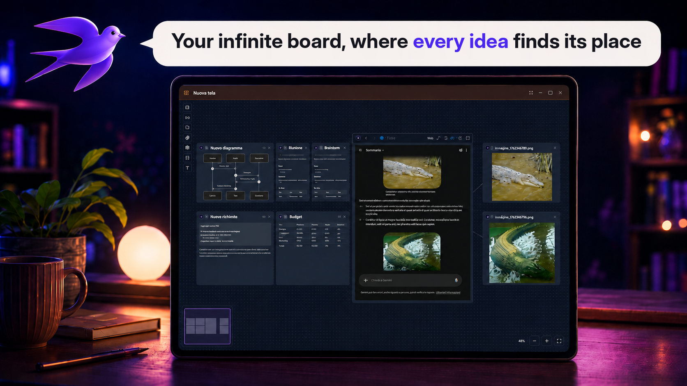

<div align="center">

# Synapse

**Your notes, on your computer. Ten kinds of note, a real editor for each one, sharing between PCs, and an AI assistant that runs locally or online.**

[](https://apps.microsoft.com/detail/9N8XRTWQGWRS?hl=it-it&gl=IT&ocid=pdpshare)
[](../../releases)
[](../../releases/latest)

🇬🇧 English · [🇮🇹 Italiano](README.it.md)

<br>



</div>

---

## In two lines

Synapse is a note-taking app for Windows that runs **on your computer**. No account, no telemetry: your data lives in a SQLite file in your own folder. Nothing leaves it unless you decide so: by sharing a note, or by picking an online AI.

What sets it apart from other note apps is that here a note isn't one single thing: there are **ten different kinds**, each with a real editor of its own, plus an assistant that can read and write them.

> **This repository holds the application, not the source code.** What you'll find here is the download, the documentation and the release notes.

---

## Download

**[⬇️ Latest version for Windows](../../releases/latest)**, or from the **[Microsoft Store](https://apps.microsoft.com/detail/9N8XRTWQGWRS?hl=it-it&gl=IT&ocid=pdpshare)**.

Download `Synapse_x.y.z_x64-setup.exe` and open it. Installing takes nothing else.

| | |
| --- | --- |
| **System** | Windows 10 (1809+) or Windows 11, 64-bit |
| **Disk** | ~60 MB installed |
| **Languages** | Italian, English, Spanish, French |
| **Dependencies** | none required |
| **Optional** | [Ollama](https://ollama.com) or an API key for the assistant, [Python](https://www.python.org) for runnable cells |

On first launch a short setup asks what you want: the AI engine, Python, the program for public links, and a master password for your password vaults. Everything except the master password can be skipped and done later from Settings.

Windows may show a SmartScreen warning the first time you run the GitHub installer: that's normal for an installer not yet signed with a commercial certificate. **More info → Run anyway.** The Microsoft Store version doesn't show it.

---

## The idea underneath: everything is text

Almost every note keeps its content as **plain text**.

| Kind | Content format |
| --- | --- |
| Postit | Markdown |
| List | Markdown task list (`- [ ] something to do`) |
| Sheet | CSV |
| Diagram | Mermaid source |
| Notebook | Markdown with ```` ```python ```` blocks |
| API | OpenAPI JSON or YAML |
| Canvas | scene JSON |
| Image | the file as an attachment, annotations as JSON |
| Video | the file as an attachment |
| Password vault | *(empty: secrets live encrypted in a table of their own)* |

That's not an implementation detail, it's the rule everything else stands on:

- **search goes inside all of it**, without a parser per kind;
- **all of it exports**, with no opaque formats;
- **the assistant reads and writes the text notes**, with no special cases;
- a notebook opened as a postit is still a sensible document.

---

## The ten kinds of note

<div align="center">

| | |
| :---: | :---: |
|  |  |
| **Postit**: rich text, attachments, links between notes | **List**: checkboxes, due dates, priorities |
|  |  |
| **Notebook**: Python and Node cells that actually run | **Canvas**: blocks on an endless plane |

</div>

### 📝 Postit
Rich text in Markdown: headings, lists, tables, quotes, code, text colours, images pasted or dragged in, attachments of any kind. The toolbar is split into labelled groups, and every button says what it does when you hover it. Type `@` and your notes appear: the link stays alive even if the note is renamed, and a click opens it in a window of its own. In a new note the title is already selected: `Enter` or `Tab` moves on to the text.

**With the assistant:** select some text and use the AI group in the toolbar: *Rewrite, Fix, Shorten, Translate, Ask*. The text is rewritten in place, and `Ctrl+Z` brings it back.

### ✅ List
Things to do: checkboxes, indentation up to four levels, drag to reorder, due dates (`📅 2026-12-31`) and priorities (⏫ 🔼 🔽). Type `@` in an item to link it to a note. The content stays Markdown, so the same note read as a postit still makes sense.

### 📊 Sheet
A real spreadsheet: formulas (`=SUM(B2:B5)`), drag to autofill, find and replace, cell colours, drop-down lists.
- **Filters** per column and A→Z / Z→A sorting.
- **Freeze** rows and columns based on what you select, both at once if you like.
- **Merge** cells across and down, vertical alignment, format painter.
- `=TODAY()`, `=NOW()`, `=YESTERDAY()`, `=TOMORROW()` write the value once, and it stays.

The content stays CSV: it opens in Excel with no conversion.

### 🔀 Diagram
You write it, it draws itself. **Mermaid** source: flowchart, sequence, class, state, gantt, ER, mindmap, timeline, git graph and the rest. Live preview as you type, a gallery of templates, pan and zoom on the drawing.

### 🧪 Notebook
Code cells that **actually run**, in an interpreter installed on your computer: **Python** and **Node**. Cells share state, output streams while the cell works, matplotlib charts come back as images. Output isn't saved: it lasts as long as the note stays open.

### 🔌 API
An **OpenAPI/Swagger** spec to read: paste it or pull it from a URL, and it becomes a browsable list of endpoints with parameters, schemas, responses and examples.

### 🎨 Canvas
Blocks laid out on an endless plane: text, linked notes, folders, files, images, frames, labels, arrows between one block and another, and even live web pages inside a block. For when things belong together because of **how they're arranged**.

### 🖼️ Image
An image from your computer (SVG included), pasted or dragged into the app, ready to annotate: pencil, highlighter, text and eraser, with colours and stroke widths, undo and redo, `Ctrl+wheel` to zoom. The original file is never changed: it exports either as the annotated PNG or as the original.

### 🎬 Video
A video from your computer, kept and played inside Synapse. Synapse stores it and plays it; it doesn't edit it.

### 🔒 Password vault
The note that isn't a note: its data doesn't live in the content, it lives **encrypted** in a table of its own. It opens with your master password, locks itself again after a while, and comes with a password generator. It isn't searched, it isn't exported in the clear, it isn't shared, and the assistant never sees it.

---

## Tags and links

Every kind of note can have **#tags** and **@links** to other notes, from the bar under the title. #tags written in the text are highlighted, and a note placed on a canvas counts as a link. Search the tags from the top bar: the list of tags with how many notes each has, then all the notes with that tag.

---

## Sharing

Two different things, both started by you and stopped whenever you want. Everything is in one place: **Sharing**, in the top bar.

**Public link.** The globe inside a note creates a link that opens in any browser, for every kind of note except password vaults. Synapse serves the page from your own computer through a free Cloudflare tunnel (no account needed). The link lasts **10 minutes**, and only while Synapse is open; the time left is shown in Sharing. Sharing a canvas also sends the notes it links to.

**Notes and folders in common.** Invite someone to a note or a whole folder with a link that lets them **edit** or only **read**. Before anyone joins, you see their name and decide. Changes travel live while both apps are open, attachments and images included (up to 100 MB each).
- The connection is **end-to-end encrypted** from PC to PC: there is no Synapse server in the middle.
- You see where the other person is working: the cell in a sheet, the pointer on a canvas, the item in a list, the cell in a notebook.
- From Sharing you see who's in, change permissions, and stop sharing. A note deleted by the other person shows a banner with *Restore*.
- Password vaults never travel.

---

## Synapse AI

<div align="center">

</div>

An assistant with the app's real tools. You choose who answers, on first launch or in Settings → *Artificial intelligence*:

| Engine | Where it runs |
| --- | --- |
| **Ollama** | on your computer: no text leaves it |
| **Claude** (Anthropic) | online, with your API key |
| **GPT** (OpenAI) | online, with your API key |
| **OpenAI-compatible** | the server whose address you enter: LM Studio, vLLM, OpenRouter, a company server… The key is optional |

With an online engine, your requests, the open note and the notes the assistant reads go to that provider, and usage is billed to your account. API keys are stored in the Windows Credential Manager, not in the database. Password vaults are never sent, whatever the engine.

It isn't a chat bolted on the side: it's a **column of the app**, and it has the app's tools:

| Tool | What it does |
| --- | --- |
| `cerca_note` | searches across all your notes, by words, tags and dates |
| `leggi_nota` | reads a note it found |
| `elenca_struttura` | looks at how your library is organised, subfolders included |
| `crea_nota` | writes a new note of the right kind, in a format that opens |
| `aggiorna_nota` | edits a note: append, find and replace, or rewrite |
| `crea_tela` | builds a canvas with notes, text, web pages and arrows |
| `crea_cartella` · `sposta_nota` · `cestina_nota` | tidies up |
| `cerca_web` · `leggi_pagina` | goes and looks online |

It **chains them**: searches, reads what it found, then writes. Every step is written down along the answer, and the pills in the trail open the note or the folder it touched. If you don't like a change, *undo* brings back the previous versions of the notes it touched.

It knows where you are (the note you have open, the folder you're in, the notes you touched recently) and who you are (two lines you write in the settings, which you can re-read and delete whenever you like). Type `@` in the chat to start from a specific note.

---

## Everything else

**Organising**: coloured categories on the home screen, folders nested as deep as you like, a file tree always on the left (`Ctrl+L`), rubber-band selection, copy/cut/paste, sort order remembered per folder.

**Windows**: a note detaches into a window of its own (assistant included), or sticks to your desktop above everything else.

**Quick note**: `Ctrl+Alt+N` from whatever program you're in: a small window appears, you type, `Ctrl+Enter`, it's gone.

**Search**: from the top bar, as you type, across titles, contents and tags of every kind, with the full path under each result.

**Import**: drag a file in. PDFs and Word files become postits, Excel and CSV become sheets, `.ipynb` becomes a notebook, images (SVG included) and videos become notes of their own.

**Export**: each kind leaves in the format that suits it. Postits and lists as Word, sheets as Excel (with computed values), diagrams as PNG, notebooks as `.ipynb`, images as annotated PNG or original file, vaults as a password-protected ZIP. A whole folder comes out as a single PDF.

**Trash**: "delete" doesn't delete. Things go to the trash, and you can bring them back for 30 days.

**Data and backup**: you choose where your data folder lives; a backup is a ZIP with the database and the attachments, made by hand or automatically, keeping the last N copies.

**Appearance and language**: light/dark/system theme, custom background, font, zoom, palettes for category colours. The interface speaks Italian, English, Spanish and French, or follows your computer.

---

## Privacy

- **Local by default.** A SQLite file in your data folder. No account, no server of ours, no telemetry.
- **Your choice of AI.** With Ollama and a locally downloaded model, your notes don't leave the computer. With Claude, GPT or an OpenAI-compatible server, what the assistant reads goes to that provider.
- **Sharing is opt-in.** A public link passes through Cloudflare and lasts 10 minutes. Notes and folders in common travel end-to-end encrypted from PC to PC.
- **Password vaults** use a key derived with **Argon2id** (64 MB, 3 passes) and content encrypted with **AES-256-GCM**, with a fresh nonce for every write. They are never shared, never sent to the AI, never searched.
- **The master password is stored nowhere.** Forget it and the secrets are lost, which is exactly why nobody else can open them.
- **Ollama and Python aren't bundled**: Synapse uses what's on your machine, and without them the app still works, just without a local assistant and without runnable cells.

The full statement, with every network connection the app can make, is in the [privacy policy](PRIVACY.md).

---

## Shortcuts

| Keys | What it does |
| --- | --- |
| `Ctrl+Alt+N` | quick note, from any program |
| `Ctrl+Alt+Enter` | shows and hides the app, from any program |
| `Ctrl+K` | opens and closes Synapse AI |
| `Ctrl+L` | opens and closes the file tree |
| `Ctrl+F` | search inside the note you have open |
| `Ctrl+wheel` | zooms an image in and out |
| `Esc` | go back one step |
| Right-click | anywhere: the actions for that thing |

---

## Questions

**Where does my data end up?**
In `C:\Users\<you>\.synapse`: database, attachments and backgrounds. From the settings you can move the folder wherever you want, another drive included.

**How do I make a backup?**
Settings → *Data and backup*. By hand whenever you like, or automatically (on every start, daily, weekly), keeping the last N copies. The `.synapsebak` file is a ZIP with the database and the attachments inside.

**Do I need an internet connection?**
No. Only for what goes online by nature: sharing, an online AI engine, web search, a web page inside a canvas.

**Is there a subscription?**
No. No account, no payment, no limits. If you pick Claude, GPT or a paid OpenAI-compatible service, that provider bills you for your usage.

**Can I use it without Ollama?**
Yes. Use an online engine with your API key, or no assistant at all: everything else works.

**Is the source code available?**
Not in this repository. What's here is the application and its documentation.

---

## Reporting a problem

Open an [issue](../../issues) and write what you were doing, what you expected and what happened instead. If the app came up blank or threw an error, attach this file:

```
%APPDATA%\com.scrig.synapse\errori.log
```

*(If you moved your data folder, the log is in the new one.)*

---

<div align="center">

Made by **Danilo Scrignoli** · Windows · Tauri 2 · SQLite

</div>
