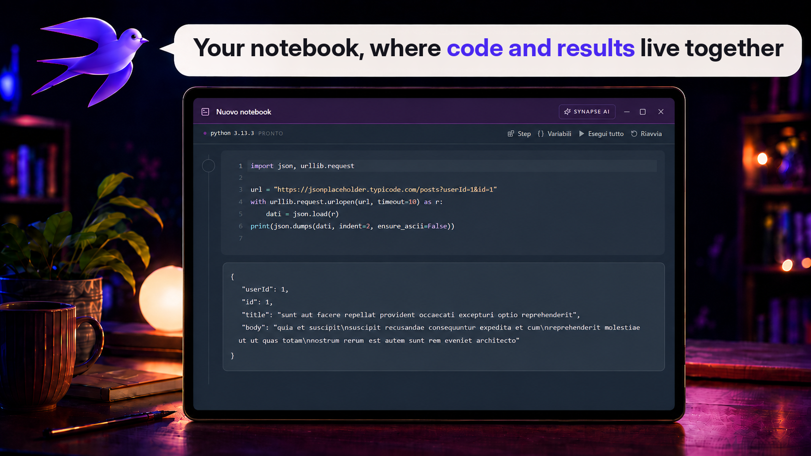
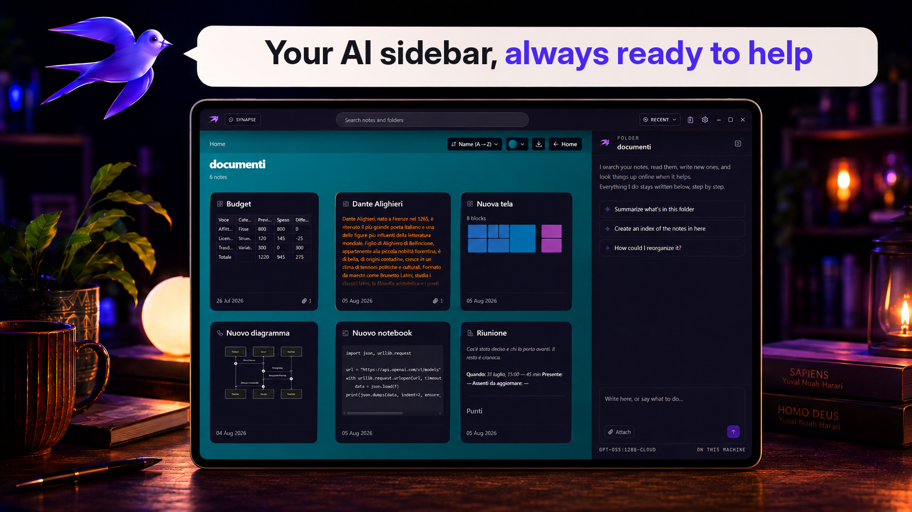

<div align="center">

# Synapse

**Your notes, on your computer. Eight kinds of note, a real editor for each one, and an assistant that runs locally.**

[](../../releases/latest)
[](../../releases)
[](../../releases/latest)

🇬🇧 English · [🇮🇹 Italiano](README.it.md)

<br>


</div>

---

## In two lines

Synapse is a note-taking app for Windows that runs **entirely on your computer**. No account, no sync, no telemetry: your data lives in a SQLite file in your own folder, and that's it.

What sets it apart from other note apps is that here a note isn't one single thing: there are **eight different kinds**, each with a real editor of its own — and a local assistant that can read and write all of them.

> **This repository holds the application, not the source code.** What you'll find here is the download, the documentation and the release notes.

---

## Download

**[⬇️ Latest version for Windows](../../releases/latest)**

Download `Synapse_x.y.z_x64-setup.exe` and open it. Installing takes nothing else.

| | |
| --- | --- |
| **System** | Windows 10 (1809+) or Windows 11, 64-bit |
| **Disk** | ~60 MB installed |
| **Dependencies** | none required |
| **Optional** | [Ollama](https://ollama.com) for the assistant, [Python](https://www.python.org) for runnable cells |

Windows may show a SmartScreen warning the first time: that's normal for an installer not yet signed with a commercial certificate. **More info → Run anyway.**

---

## The idea underneath: everything is text

Every note, whatever its kind, keeps its content as **plain text**.

| Kind | Content format |
| --- | --- |
| Postit | Markdown |
| List | Markdown task list (`- [ ] something to do`) |
| Sheet | CSV |
| Diagram | Mermaid source |
| Notebook | Markdown with ```` ```python ```` blocks |
| API | OpenAPI JSON or YAML |
| Canvas | scene JSON |
| Password vault | *(empty — secrets live encrypted in a table of their own)* |

That's not an implementation detail, it's the rule everything else stands on:

- **search goes inside all of it**, without a parser per kind;
- **all of it exports**, with no opaque formats;
- **the assistant reads and writes all of it**, with no special cases;
- a notebook opened as a postit is still a sensible document.

---

## The eight kinds of note

<div align="center">

| | |
| :---: | :---: |
|  |  |
| **Postit** — rich text, attachments, links between notes | **List** — checkboxes, due dates, priorities |
|  |  |
| **Notebook** — Python and Node cells that actually run | **Canvas** — blocks on an endless plane |

</div>

### 📝 Postit
Rich text in Markdown. Headings, lists, tables, quotes, code, text colours, images pasted or dragged in, attachments of any kind. Type `[[` and your notes appear: the link stays alive even if the note is renamed.

**With the assistant:** highlight a sentence and pick *rewrite, fix, shorten, translate* — or just say what to do with it. The text is rewritten in place, and `Ctrl+Z` brings it back.

### ✅ List
Things to do: checkboxes, indentation up to four levels, drag to reorder, due dates (`📅 2026-12-31`) and priorities (⏫ 🔼 🔽). The content stays Markdown, so the same note read as a postit still makes sense.

### 📊 Sheet
A real spreadsheet: formulas (`=SUM(B2:B5)`), drag to autofill, find and replace, per-column filters, cell validation, background colours. The content stays CSV: it opens in Excel with no conversion.

### 🔀 Diagram
You write it, it draws itself. **Mermaid** source: flowchart, sequence, class, state, gantt, ER, mindmap, timeline, git graph and the rest. Live preview as you type, a gallery of templates, pan and zoom on the drawing.

### 🧪 Notebook
Code cells that **actually run**, in an interpreter installed on your computer: **Python** and **Node**. Cells share state, output streams while the cell works, matplotlib charts come back as images. Output isn't saved: it lasts as long as the note stays open.

### 🔌 API
An **OpenAPI/Swagger** spec to read: paste it or pull it from a URL, and it becomes a browsable list of endpoints with parameters, schemas, responses and examples.

### 🎨 Canvas
Blocks laid out on an endless plane: text, linked notes, files, images, frames, labels, arrows between one block and another — and even live web pages inside a block. For when things belong together because of **how they're arranged**.

### 🔒 Password vault
The note that isn't a note: its data doesn't live in the content, it lives **encrypted** in a table of its own. It opens with your master password, locks itself again after a while, and comes with a password generator. It isn't searched, it isn't exported in the clear, and the assistant never sees it.

---

## Synapse AI

<div align="center">

</div>

An assistant that runs **locally** with [Ollama](https://ollama.com). No text leaves your computer.

It isn't a chat bolted on the side: it's a **column of the app**, and it has the app's real tools —

| Tool | What it does |
| --- | --- |
| `cerca_note` | searches across all your notes |
| `leggi_nota` | reads a note it found |
| `elenca_struttura` | looks at how your library is organised |
| `crea_nota` | writes a new note, of the right kind |
| `aggiorna_nota` | rewrites a note that already exists |
| `crea_cartella` · `sposta_nota` · `cestina_nota` | tidies up |
| `cerca_web` · `leggi_pagina` | goes and looks online |

It **chains them**: searches, reads what it found, then writes. Everything it does is written down step by step, and the pills in the trail are clickable — they open the note or the folder it touched.

It knows where you are (the note you have open, the folder you're in) and who you are (two lines you write in the settings, which you can re-read and delete whenever you like).

---

## Everything else

**Organising** — coloured categories on the home screen, folders nested as deep as you like, a file tree always on the left (`Ctrl+L`), rubber-band selection, copy/cut/paste, sort order remembered per folder.

**Windows** — a note detaches into a window of its own (assistant included), or sticks to your desktop above everything else.

**Quick note** — `Ctrl+Alt+N` from whatever program you're in: a small window appears, you type, `Ctrl+Enter`, it's gone.

**Search** — from the top bar, as you type, across titles and contents of every kind, with the full path under each result.

**Import** — drag a file in: PDFs and Word files become postits, Excel and CSV become sheets, `.ipynb` becomes a notebook.

**Export** — each kind leaves in the format that suits it: postits and lists as Word, sheets as Excel (with computed values), diagrams as PNG, notebooks as `.ipynb`, vaults as a password-protected ZIP. A whole folder comes out as a single PDF.

**Trash** — "delete" doesn't delete: it goes to the trash, and you can bring it back for 30 days.

**Data and backup** — you choose where your data folder lives; a backup is a ZIP with the database and the attachments, made by hand or automatically, keeping the last N copies.

**Appearance** — light/dark/system theme, custom background, font, zoom, seven palettes for category colours.

---

## Privacy

- **All local.** A SQLite file in your data folder. No account, no server, no telemetry.
- **The assistant runs on your machine** with Ollama: with a locally downloaded model, your notes don't leave it. Ollama's *cloud* models are the exception — see the [privacy policy](PRIVACY.md).
- **Password vaults** use a key derived with **Argon2id** (64 MB, 3 passes) and content encrypted with **AES-256-GCM**, with a fresh nonce for every write.
- **The master password is stored nowhere.** Forget it and the secrets are lost — which is exactly why nobody else can open them.
- **Nothing is sent anywhere.** The full statement is in the [privacy policy](PRIVACY.md).
- **Ollama and Python aren't bundled**: Synapse uses what's on your machine, and without them the app still works — just without the assistant and without runnable cells.

---

## Shortcuts

| Keys | What it does |
| --- | --- |
| `Ctrl+Alt+N` | quick note, from any program |
| `Ctrl+Alt+Enter` | shows and hides the app, from any program |
| `Ctrl+K` | opens and closes Synapse AI |
| `Ctrl+L` | opens and closes the file tree |
| `Ctrl+F` | search inside the note you have open |
| `Esc` | go back one step |
| Right-click | anywhere: the actions for that thing |

---

## Questions

**Where does my data end up?**
In `C:\Users\<you>\.synapse` — database, attachments and backgrounds. From the settings you can move the folder wherever you want, another drive included.

**How do I make a backup?**
Settings → *Data and backup*. By hand whenever you like, or automatically (on every start, daily, weekly), keeping the last N copies. The `.synapsebak` file is a ZIP with the database and the attachments inside.

**Do I need an internet connection?**
No. Only if you ask the assistant to search online, or open a web page inside a canvas.

**Is there a subscription?**
No. No account, no payment, no limits.

**Can I use it without Ollama?**
Yes. Without it there's no assistant: everything else works.

**Is the source code available?**
Not in this repository. What's here is the application and its documentation.

---

## Reporting a problem

Open an [issue](../../issues) and write what you were doing, what you expected and what happened instead. If the app came up blank or threw an error, attach this file:

```
%APPDATA%\com.scrig.synapse\errori.log
```

*(If you moved your data folder, the log is in the new one.)*

---

<div align="center">

Made by **Danilo Scrignoli** · Windows · Tauri 2 · SQLite

</div>
